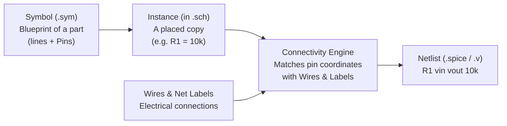

# 1. What is Schematic Capture?

When you look at an electronic circuit diagram on a screen, your eyes see **lines, boxes, and labels**. When a circuit simulator like **ngspice** runs a simulation, it needs **which component pins share an electrical node**.

A **schematic capture and netlisting tool** (like xschem, and now **SchemCraft**) bridges those two worlds:
1. **Schematic Capture:** A 2D CAD editor for drawing circuit diagrams cleanly.
2. **Netlisting:** An algorithm that reads the 2D drawing, figures out what is electrically connected, and outputs a text file (a **netlist**, such as SPICE, Verilog, or VHDL) that simulators and chip layout tools understand.

---

## The 6 Core Concepts You Need to Know



### 1. Cosmetic Graphics (`Line`, `Rect`, `Polygon`, `Arc`, `Text`)
These are pure drawings. They help humans read the diagram (for example, the zig-zag body of a resistor or the triangle of an op-amp), but **they carry no electricity**.

### 2. Symbols (`.sym` files) — The Blueprint
A **Symbol** is a reusable template for a component: a resistor, an NMOS transistor, an op-amp, or a subcircuit block.
- It contains **cosmetic graphics** (so it looks like a resistor).
- It contains **Pins** (special rectangles on the pin layer that mark the exact `(x, y)` points where wires can attach, like `PLUS` and `MINUS`, or `D`, `G`, `S`, `B`).
- It contains a **template / format string** that tells the netlister how to print this component in SPICE or Verilog.

### 3. Instances (`Component` placed in a `.sch` file) — A Real Part
You don't draw a new resistor from scratch every time you need one. Instead, inside a **Schematic (`.sch`)**, you place an **Instance** of a symbol:
- **Symbol reference:** `"res.sym"`
- **Position & orientation:** `(x, y)`, rotation (`0`, `90`, `180`, `270`), flip (`flip_x`).
- **Properties (Attributes):** Key-value pairs specific to *this* copy, such as `name=R1 value=10k`.
- You can place 100 instances of `res.sym` in one schematic (`R1`, `R2`, ..., `R100`), each at a different position and with a different resistance value.

### 4. Wires vs. Nets (The Most Important Distinction!)
Beginners often confuse **wires** and **nets**:
- A **Wire** is a single graphic line segment from `(x1, y1)` to `(x2, y2)` drawn by the user.
- A **Net** (short for *electrical network* or *node*) is the **logical group of everything electrically connected together**.
  - Two wires that touch at an endpoint (or a T-junction) belong to the **same net**.
  - Two wires on opposite sides of the page that both have a net label `VDD` also belong to the **same net**, even though they don't physically touch on screen!

### 5. Hierarchy (Schematics inside Schematics)
Real chips have millions of transistors. You don't draw them on one flat page:
- You draw an `inverter.sch` schematic (with 2 transistors) and give it a matching symbol `inverter.sym` with pins `IN`, `OUT`, `VDD`, `GND`.
- Then, inside a `ring_oscillator.sch` schematic, you place 5 instances of `inverter.sym`.
- Clicking an instance and "descending" into it opens the underlying `inverter.sch`.

### 6. Netlisting
Once your schematic is drawn, the **netlister** walks the schematic:
1. Calculates the world `(x, y)` coordinates of every instance's pins (taking rotation and flip into account).
2. Finds which wires and labels touch which pins to assign a unique **Net Name** (like `net1`, `vin`, `vout`, `0`/ground) to every connected island.
3. Emits text for your simulator, e.g. in SPICE:
   ```spice
   R1 vin vout 10k
   C1 vout 0 1p
   ```

---

## How This Maps to SchemCraft's Crates
- [`crates/core`](file:///Users/loki/Workspace/GitHub_Repos/xschem_rust/crates/core/src/lib.rs) holds the in-memory data structures (`Point`, `Wire`, and soon `Symbol`, `Instance`, `Schematic`).
- [`crates/format`](file:///Users/loki/Workspace/GitHub_Repos/xschem_rust/crates/format/src/lib.rs) reads and writes `.sch` and `.sym` text files into those structures.
- [`crates/netlist`](file:///Users/loki/Workspace/GitHub_Repos/xschem_rust/crates/netlist/src/lib.rs) computes the nets from the wires/pins and prints SPICE/Verilog/VHDL.
