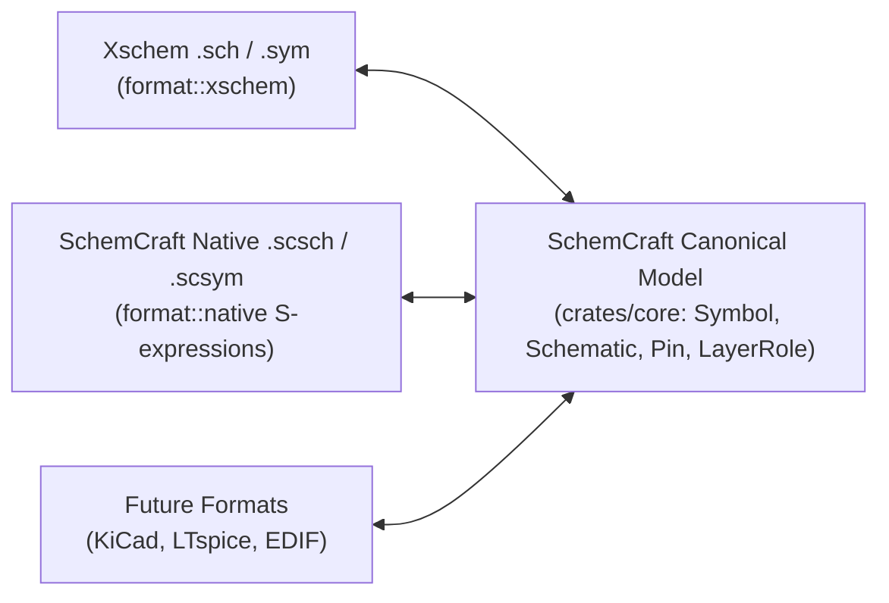

# 2. The Xschem File Format vs. SchemCraft's Canonical Model

One of the key architectural decisions in SchemCraft ([ADR 0002](../../plan/adr/0002-canonical-core-and-format-codecs.md)) is separating **SchemCraft's Canonical Domain Model** (`crates/core`) from **File Format Codecs** (`crates/format`):



Let's first dissect how xschem's ASCII `.sch` and `.sym` files work on disk, and then see how our `format::xschem` codec translates them into `schemcraft-core`—and how they compare to SchemCraft's native S-expression format.

---

## 1. Xschem's ASCII Format: Every Record Starts With a 1-Letter Tag

An xschem `.sch` or `.sym` file is a sequence of plain-text records. Each record begins with a single ASCII character tag, followed by numbers and/or `{...}` braced strings:

| Xschem Tag | Meaning in Xschem | How `schemcraft-core` Models It |
|---|---|---|
| `v`, `G`, `K`, `V`, `S`, `F`, `E` | Version & global property blocks (VHDL, Symbol, Verilog, SPICE, Spectre, tEDAx) | `Symbol::props` / `Schematic::props` + [`XschemHeaders`](file:///Users/loki/Workspace/GitHub_Repos/xschem_rust/crates/core/src/props.rs#L39-L56) passthrough |
| `L` | **Line** segment on an integer layer (`0..N`) | [`Line`](file:///Users/loki/Workspace/GitHub_Repos/xschem_rust/crates/core/src/graphics.rs#L37-L43) with semantic [`LayerRole`](file:///Users/loki/Workspace/GitHub_Repos/xschem_rust/crates/core/src/graphics.rs#L14-L34) |
| `B` (layer ≠ 5) | **Box (Rectangle)** on a cosmetic layer | [`Rect`](file:///Users/loki/Workspace/GitHub_Repos/xschem_rust/crates/core/src/graphics.rs#L46-L52) with semantic [`LayerRole`](file:///Users/loki/Workspace/GitHub_Repos/xschem_rust/crates/core/src/graphics.rs#L14-L34) |
| `B 5 ...` | **Box on Layer 5 (`PINLAYER`)** = Electrical Pin! | First-class [`Pin`](file:///Users/loki/Workspace/GitHub_Repos/xschem_rust/crates/core/src/document.rs#L48-L60) on [`Symbol::pins`](file:///Users/loki/Workspace/GitHub_Repos/xschem_rust/crates/core/src/document.rs#L127) |
| `A` | **Arc / Circle** on a layer | [`Arc`](file:///Users/loki/Workspace/GitHub_Repos/xschem_rust/crates/core/src/graphics.rs#L55-L63) |
| `P` | **Polygon / Polyline** on a layer | [`Polygon`](file:///Users/loki/Workspace/GitHub_Repos/xschem_rust/crates/core/src/graphics.rs#L66-L71) |
| `T` | **Text** label | [`Text`](file:///Users/loki/Workspace/GitHub_Repos/xschem_rust/crates/core/src/graphics.rs#L74-L85) |
| `N` | **Electrical Wire** segment | [`Wire`](file:///Users/loki/Workspace/GitHub_Repos/xschem_rust/crates/core/src/document.rs#L87-L92) on [`Schematic::wires`](file:///Users/loki/Workspace/GitHub_Repos/xschem_rust/crates/core/src/document.rs#L140) |
| `C` | **Component Instance** (places a `.sym`) | [`Instance`](file:///Users/loki/Workspace/GitHub_Repos/xschem_rust/crates/core/src/document.rs#L103-L114) on [`Schematic::instances`](file:///Users/loki/Workspace/GitHub_Repos/xschem_rust/crates/core/src/document.rs#L142) |
| `[`...`]` | Optional inline embedded symbol definition | `Instance::embedded_symbol: Option<Symbol>` |

---

## 2. Inside a Real Xschem Symbol File (`res.sym`)

Here is a simplified view of `devices/res.sym`:

```text
v {xschem version=3.4.8RC file_version=1.2}
G {}
K {type=resistor
format="@name @pinlist @value m=@m"
template="name=R1
value=1k
footprint=1206
device=resistor
m=1"
}
V {}
S {}
F {}
E {}
L 4 0 20 0 30 {}
L 4 0 20 7.5 17.5 {}
...
B 5 -2.5 -32.5 2.5 -27.5 {name=P dir=inout propag=1 pinnumber=1 goto=1}
B 5 -2.5 27.5 2.5 32.5 {name=M dir=inout propag=0 pinnumber=2 goto=0}
T {@name} 15 -18.75 0 0 0.2 0.2 {}
T {@value} 15 -6.25 0 0 0.2 0.2 {}
```

Look closely at how xschem encodes things vs. how `schemcraft-core` cleans them up:

1. **Pins (`B 5 ...` → [`Pin`](file:///Users/loki/Workspace/GitHub_Repos/xschem_rust/crates/core/src/document.rs#L48-L60)):**
   - In xschem, there is no `PIN` tag—a pin is a `B` (Box) on magic layer `5` (`B 5 -2.5 -32.5 2.5 -27.5 {name=P dir=inout ...}`).
   - When our `format::xschem` parser reads a `.sym`, it converts every `B 5` record into a first-class [`Pin`](file:///Users/loki/Workspace/GitHub_Repos/xschem_rust/crates/core/src/document.rs#L48-L60) with `name: "P"`, `dir: PinDirection::InOut`, `pos: Point::new(0.0, -30.0)` (the center of the box), and `size: Point::new(5.0, 5.0)`.
   - When saving back to `.sym`, [`Pin::bounds()`](file:///Users/loki/Workspace/GitHub_Repos/xschem_rust/crates/core/src/document.rs#L74-L82) reconstructs the exact `-2.5 -32.5 2.5 -27.5` box coordinates!
2. **Layers (`4`, `13`, `15`, `17` → [`LayerRole`](file:///Users/loki/Workspace/GitHub_Repos/xschem_rust/crates/core/src/graphics.rs#L14-L34)):**
   - Xschem uses integer color indices (`4` = symbol body, `13` = pin numbers, `15` = net names, `17` = simulation annotations).
   - `schemcraft-core` maps these to semantic variants (`LayerRole::SymbolBody`, `LayerRole::PinAnnotation`, etc.), while any custom layer number maps to `LayerRole::Custom(n)` so nothing is ever lost.

---

## 3. Inside a Real Xschem Schematic File (`Q1.sch`)

```text
N 440 -160 440 -100 {lab=P1}
C {res.sym} 440 -190 0 0 {name=Re value=2.158 footprint=1206 device=resistor m=1}
C {res.sym} 190 -380 3 1 {name=Rbx value="3.723" footprint=1206 device=resistor m=1}
```

- **Wires (`N`):** `N <x1> <y1> <x2> <y2> {<props>}` → [`Wire`](file:///Users/loki/Workspace/GitHub_Repos/xschem_rust/crates/core/src/document.rs#L87-L92).
- **Component Instances (`C`):** `C {<symbol>} <x> <y> <rot> <flip> {<props>}` → [`Instance`](file:///Users/loki/Workspace/GitHub_Repos/xschem_rust/crates/core/src/document.rs#L103-L114).

---

## 4. How `{...}` Braced Strings and Escaping Work in Xschem

In xschem's `save.c` (`load_ascii_string` and `save_ascii_string`):
1. Every string block starts with `{` and ends with the matching unescaped `}`.
2. **Strings can span multiple lines!** Newlines inside `{...}` are part of the string content.
3. Inside `{...}`, only three characters are escaped with a backslash `\`:
   - `\\` → literal `\`
   - `\{` → literal `{`
   - `\}` → literal `}`
4. Inside a property block like `{name=R1 device="ceramic capacitor"}`, attributes are whitespace-separated `key=value` pairs. Values containing spaces or newlines are enclosed in `"..."`.

---

## 5. Preview: SchemCraft's Native S-Expression Format (`.scsch` / `.scsym`)

Alongside 100% compatibility with xschem `.sch`/`.sym` files, SchemCraft also defines its own native S-expression format (`format::native`), inspired by modern KiCad:

```lisp
(schemcraft_sym (version 1)
  (prop "type" "resistor")
  (prop "format" "@name @pinlist @value m=@m")
  (pin "P" (dir inout) (at 0 -30) (size 5 5) (prop "pinnumber" "1"))
  (pin "M" (dir inout) (at 0 30)  (size 5 5) (prop "pinnumber" "2"))
  (line (layer symbol_body) (from 0 20) (to 0 30))
)
```
- **One line per pin, wire, or shape** → clean `git diff`s with zero trailing-comma conflicts.
- **Self-describing `(key value)` fields** → forward-compatible as SchemCraft evolves.
