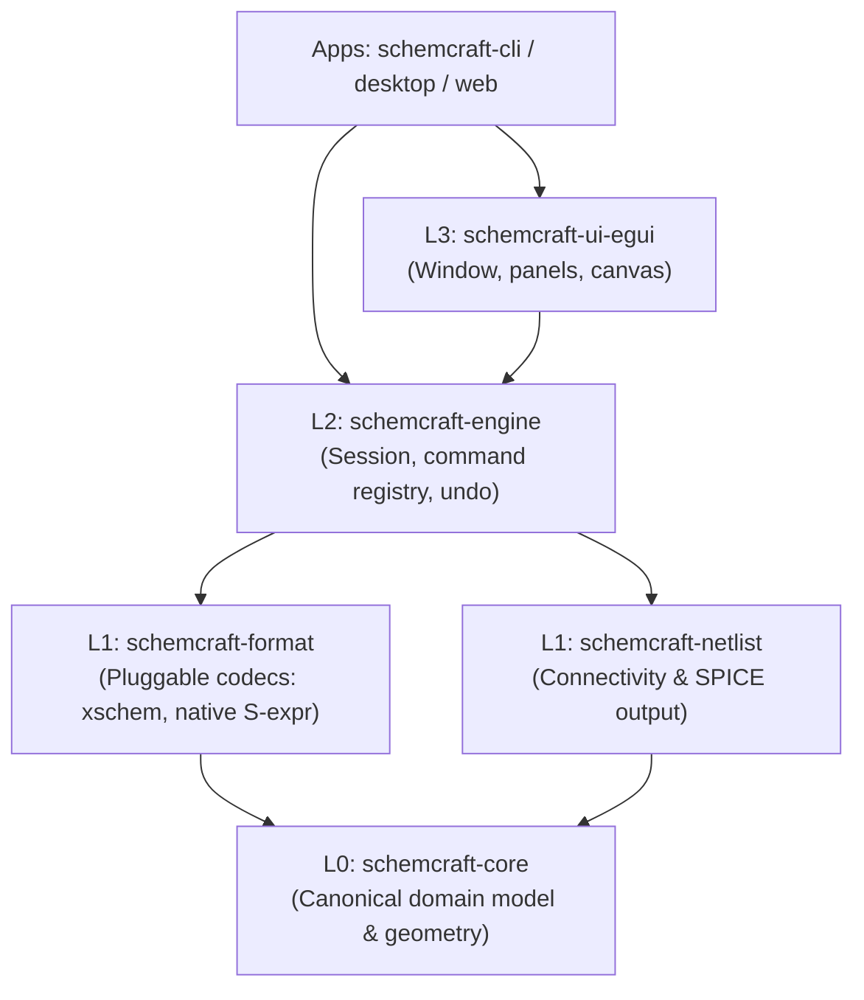

# 1. Workspaces, Crates, Modules, and Layering in Rust

If you are new to Rust, the first thing you notice in SchemCraft is that we don't have just one `src/` folder. Instead, we have a root [`Cargo.toml`](file:///Users/loki/Workspace/GitHub_Repos/xschem_rust/Cargo.toml), several crates under `crates/` and `apps/`, and small focused module files inside each crate.

Here is why, and how to read it.

---

## 1. What is a Crate?
In Rust, the unit of compilation is called a **crate** (similar to a package or library in other languages). There are two kinds:
- **Library crate (`src/lib.rs`):** Reusable code that does not have a `main()` function. All our folders in `crates/*` are library crates.
- **Binary crate (`src/main.rs`):** An executable program with a `fn main()` entry point. Our folders in `apps/*` (like [`apps/schemcraft-cli`](file:///Users/loki/Workspace/GitHub_Repos/xschem_rust/apps/schemcraft-cli/src/main.rs)) and [`xtask`](file:///Users/loki/Workspace/GitHub_Repos/xschem_rust/xtask/src/main.rs) are binary crates.

## 2. How Multi-File Modules Work Inside a Crate (`pub mod` and `pub use`)
Unlike C or Python, Rust does **not** automatically compile every `.rs` file sitting in `src/`. Instead, [`src/lib.rs`](file:///Users/loki/Workspace/GitHub_Repos/xschem_rust/crates/core/src/lib.rs) is the **table of contents** of the crate.

Look at [`crates/core/src/lib.rs`](file:///Users/loki/Workspace/GitHub_Repos/xschem_rust/crates/core/src/lib.rs):
```rust
pub mod document;
pub mod geometry;
pub mod graphics;
pub mod props;

pub use document::{
    DEFAULT_PIN_SIZE, Document, Instance, Pin, PinDirection, Schematic, Symbol, Wire,
};
pub use geometry::{Point, Rotation};
pub use graphics::{Arc, Graphics, LayerRole, Line, Polygon, Rect, Text};
pub use props::{Properties, XschemHeaders};
```
1. **`pub mod geometry;`** tells the compiler: *"Look for [`crates/core/src/geometry.rs`](file:///Users/loki/Workspace/GitHub_Repos/xschem_rust/crates/core/src/geometry.rs) (or `geometry/mod.rs`), compile it as a submodule, and make it public."*
2. **Inside submodules, `crate::` refers to the crate root:** For example, [`graphics.rs`](file:///Users/loki/Workspace/GitHub_Repos/xschem_rust/crates/core/src/graphics.rs) imports `Point` from its sibling module by writing `use crate::geometry::{Point, Rotation};`.
3. **`pub use ...` (The Facade Pattern):** By re-exporting key types at the root of `lib.rs`, each source file stays small and focused (~60–150 lines), while downstream crates can still write a short, ergonomic import like `use schemcraft_core::{Schematic, Symbol, Pin, Point};`!

---

## 3. What is a Cargo Workspace?
A **Cargo Workspace** lets multiple crates live in one Git repository, share a single `Cargo.lock` (so everyone uses the exact same dependency versions), and share a single `target/` build directory (so dependencies are compiled only once).

Look at the top of [`Cargo.toml`](file:///Users/loki/Workspace/GitHub_Repos/xschem_rust/Cargo.toml):
```toml
[workspace]
resolver = "3"
members = ["crates/*", "apps/*", "xtask"]
exclude = ["reference"]
```
- `members` tells Cargo: "Every folder inside `crates/`, `apps/`, plus `xtask` is part of this workspace."
- `[workspace.dependencies]` defines external libraries (like `serde` for JSON serialization and `thiserror` for clean error types) in **one central place**. Individual crates then opt in with `serde.workspace = true`.

---

## 4. Why Strict Layering (`L0` → `L3`)?

In many large projects, UI code, file parsing, and circuit math accidentally get tangled together. Soon you can't run a quick test on a netlist without opening a GPU window, and you can't compile to WebAssembly because a deep math file tries to open a desktop file dialog.

SchemCraft prevents this by organizing crates into **numbered layers** and enforcing them automatically with `cargo xtask layers`:



**The Golden Rule:** A crate at Layer $N$ may only depend on crates at a **strictly lower layer** ($< N$), and nothing below `L3` is ever allowed to depend on GUI libraries (`egui`, `wgpu`, `winit`).

What this gives us for free:
1. **Fast unit tests:** Testing `core`, `format`, `netlist`, and `engine` takes milliseconds because no GUI libraries are compiled.
2. **WebAssembly ready:** Layers `L0`–`L2` use pure memory (`&str`, `Vec`, structs) with zero OS-specific code, so they compile straight to the browser.
3. **Swappable UI:** If we ever want a second UI alongside `egui`, we just add another `L3` crate without touching a single line of `L0`–`L2`.
