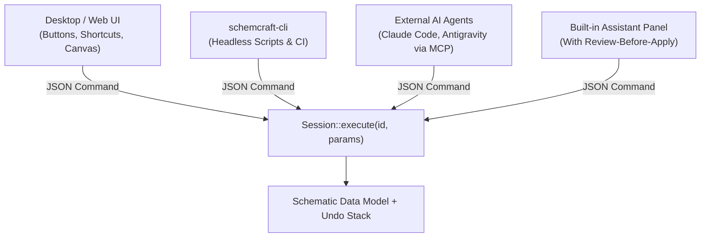

# 1. The Command Engine & AI-First Design

Open [`crates/engine/src/lib.rs`](file:///Users/loki/Workspace/GitHub_Repos/xschem_rust/crates/engine/src/lib.rs). Even in our tiny scaffold, you can see the core architectural idea of SchemCraft:

```rust
pub struct Session {
    pub schematic: Schematic,
}

impl Session {
    /// Run a command by id with JSON parameters. Never opens a dialog.
    pub fn execute(&mut self, id: &str, _params: &Value) -> Result<Value, EngineError> {
        match id {
            "sch.wire.count" => Ok(Value::from(self.schematic.wires.len())),
            other => Err(EngineError::UnknownCommand(other.to_owned())),
        }
    }
}
```

## Why "Everything is a Command"?

In traditional desktop apps, clicking a toolbar button runs a callback right inside the GUI code that directly mutates the schematic. That makes it almost impossible for an AI agent, a CLI script, or an automated test to do what a human does.

In SchemCraft, **every action is a named command** (like `"sch.wire.add"`, `"sch.instance.place"`, `"netlist.spice"`) that takes a JSON input (`serde_json::Value`) and returns a JSON output (`Result<Value, EngineError>`):



Notice the Rust signature on `execute`:
```rust
pub fn execute(&mut self, id: &str, _params: &Value) -> Result<Value, EngineError>
```
- `&mut self`: A **mutable borrow** of the `Session` (because commands can modify `self.schematic` and the undo history).
- `id: &str`: A **borrowed string slice** naming the command (no memory allocation needed just to pass `"sch.wire.count"`).
- `_params: &Value`: A **shared (read-only) borrow** of the JSON parameters.
- `Result<Value, EngineError>`: Always returns either a JSON result (`Ok(...)`) or a structured error (`Err(...)`)—never a crash and never a blocking pop-up dialog.
